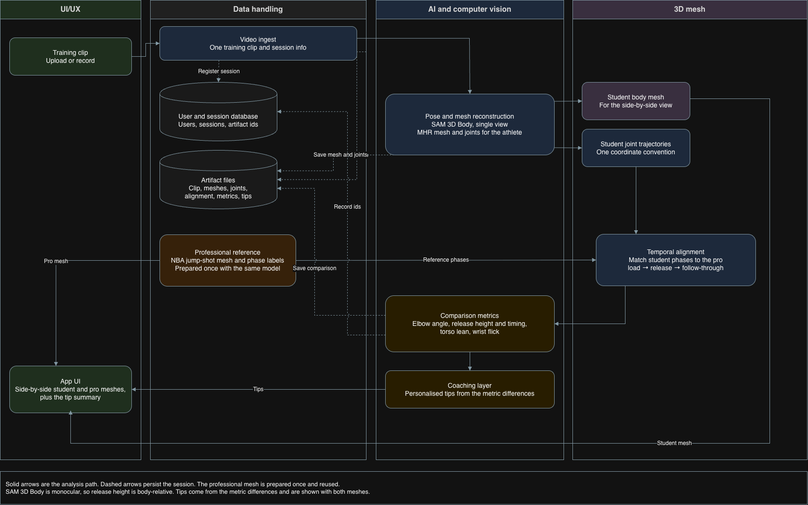

# Court Sense AI — 3D Mesh Jump Shot Analysis

HKUST Final Year Project. This is an application that analyses individual basketball training footage, reconstructs a 3D mesh of the athlete’s jump shot, and compares it against a 3D mesh of a professional NBA player. From that comparison, the system aims to provide personalised tips for improving jump shot accuracy.

## Pipeline (work in progress)

1. **Video ingest** — upload or record training clips
2. **Pose / mesh reconstruction** — estimate body pose and build a 3D mesh from footage
3. **Temporal alignment (tbc)** — sync student vs professional shot phases (load → release → follow-through)
4. **Comparison metrics (tbc)** — elbow angle, release height/timing, torso lean, wrist flick, and related biomechanics
5. **Coaching layer** — map metric differences to personalised coaching tips
6. **App UI** — side-by-side 3D visualisation and tip summary

## System architecture

The following diagram shows the intended end-to-end CourtSense architecture.
The current prototype implements only the offline data-handling path with
synthetic camera input and mock reconstruction; SAM 3D Body, multi-view
reconstruction, validated biomechanics, coaching, and the UI remain future
integration points.



## M1 offline data pipeline

The repository now contains a small, executable vertical slice for development:

```text
synthetic cameras
    -> timestamp pairing
    -> mock reconstruction
    -> quality validation
    -> shot segmentation and features
    -> consent-aware retention decision
```

The M1 workflow is intentionally in-memory. It does not save camera frames,
videos, meshes, or feature payloads. Reconstruction output is explicitly marked
`mock_synthetic` and is not a validated biomechanics result. SQLite metadata,
artifact persistence, Parquet dataset export, deletion, and withdrawal are
planned for the next milestone.

### Run the prototype

```bash
python -m pip install -e '.[dev]'
PYTHONPATH=src python -m courtsense.cli --retention none
PYTHONPATH=src python -m courtsense.cli --retention history
PYTHONPATH=src python -m courtsense.cli --retention training
python -m pytest -q
```

The three retention choices are deliberately separate:

- `none`: analyze temporarily and retain no derived artifacts.
- `history`: retain approved derived results, but do not grant training consent.
- `training`: permit approved derived results to be considered for a future
  training dataset.

The local CLI uses a single-operator trust model. A participant ID is
pseudonymous metadata, not an authentication credential.

## Clone the repository

```bash
git clone https://github.com/gugusiow/court-sense-ai-3d-mesh.git
cd court-sense-ai-3d-mesh
```

## Commit message format

We follow a lightweight Conventional Commits style:

`<type>(<scope>): <short subject>`

Types: feat, fix, refactor, chore, docs, test, perf, style.

Examples:
- feat(pose): add 2D keypoint detector baseline
- fix(data): handle missing frames in video loader
- docs(readme): add instructions
