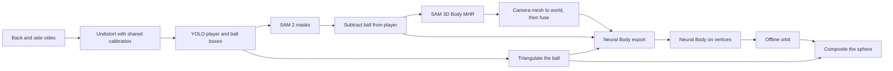

# Two-view mesh-guided novel view synthesis

This is the experiment on `nvs_test`. Two synchronized cameras, a back view
and a side view, are turned into a dataset that a human-mesh-guided radiance
field can train on. The basketball is stored as its own object so the body
model does not paint it onto the hand.

## Recommendation

Use [Neural Body](https://github.com/zju3dv/neuralbody) (CVPR 2021, TPAMI
2023, ZJU 3DV). It is the mesh-anchored human NeRF whose training format is
still the one later human-avatar papers read.

Neural Body attaches a learned appearance code to each body vertex, diffuses
those codes into a volume, and renders with a NeRF. The network never reads
SMPL joint angles. It reads the posed vertex positions. SAM 3D Body already
outputs those positions as an MHR mesh, so the adapter is "load
`vertices/{frame}.npy` instead of running SMPL" plus "size the code table to
the MHR vertex count".

That is the adaptation that stays well-defined. Meta's MHR authors say a
mapping from MHR pose parameters onto SMPL pose is not plausible: the
skeleton, the skinning weights, and the pose correctives are different
([sam-3d-body#68](https://github.com/facebookresearch/sam-3d-body/issues/68)).
Animatable NeRF (`zju3dv/animatable_nerf`) is built on SMPL's 24-joint blend
weights, so it needs that mapping before it can train. Animatable Gaussians
and GART are the same kind of dependency, and they are Gaussian splatting
methods rather than NeRFs. They are the right follow-on if the goal becomes
a real-time orbit, after this export is known to be geometrically consistent.

Neural Body is reference code, not a product that is still being developed.
The lab's last dataset update was January 2024. The official install is
Python 3.7, PyTorch 1.4, and a pinned spconv, and it is a Linux install.
Keep it in its own environment or the published Docker image. The
preprocessing environment in this repository is a current Python 3.11 stack.
The files under the export directory are the only thing the two environments
share.

### What two cameras can show

Neural Body's published results use four or more cameras. A back camera and
a side camera leave the front of the player unobserved. The orbit will be
constrained on the filmed sides and invented on the front. There is no
held-out camera to score with a number. The check is the training-view
reprojection plus a look at the orbit.

The novel-view tool renders an orbit of one frame
(`vis_novel_view`, `num_render_views`). A fixed camera playing the shot is
the other released mode. An orbit that moves while the shot plays is a loop
over those two controls after a checkpoint exists. It writes images. It is
not an interactive viewer. Real-time playback is a later Gaussian model that
can consume the same `vertices/` files.

## Architecture



SAM 3D Body is a single-image model. Each view produces its own MHR mesh in
that camera's frame. The calibrated extrinsics put both meshes in one world.
The vertices are averaged when the root-mean-square difference is at most
8 cm. Above that, the more confident view is kept whole. Averaging the 204
MHR pose numbers is intentionally not done: a bad hand from one view would
bend the other view's hand, and those numbers are not in the camera frame.
Per-view parameters, including `mhr_model_params`, are still saved under
`mhr/` for a later multi-view fit.

The official estimator crops the player internally from the box
(`TopdownAffine`). This pipeline passes the full undistorted frame, the YOLO
box, the ball-free mask, and the real `K`. Cropping the image first would
move the principal point, and the two meshes would no longer meet.

The ball mask is dilated by a few pixels and that halo is removed from the
player mask. The saved ball mask keeps the original SAM 2 size. Neural Body
trains on `mask/`, so ball pixels never supervise the body. After rendering,
`scripts/composite_ball.py` draws the triangulated sphere. A body depth map,
when you have one, hides the sphere where the player is in front.

## Export layout

```text
data/nvs/shot/
  annots.npy                 Neural Body cameras and frame list
  cameras_export.json        intrinsics after undistort, distortion zero
  metadata.json
  summary.json
  frames.jsonl
  images/0/000000.jpg        camera 0 is back, camera 1 is side
  images/1/000000.jpg
  mask/0/000000.png          player, ball removed
  mask_ball/0/000000.png     ball only
  vertices/000000.npy        fused world mesh, meters, float32
  vertices/000000.ply        frame 0, for MeshLab
  mhr/0/000000.npz           per-view MHR parameters and world vertices
  mhr_faces.npy
  ball/000000.npz            center, radius, validity
  ball_trajectory.npz
  detections/0/000000.json   used by the second mesh pass
```

`annots.npy` follows ZJU-MoCap: `cams.K`, `cams.R`, `cams.T`, `cams.D`, and
`ims[].ims`. `T` is in millimeters. `D` is zero because the images are
already undistorted. Vertex files are meters in the calibration world.

The released SAM 3D Body mesh has 18439 vertices. The exporter writes
however many the checkpoint returns. Neural Body's latent-code table has to
match that count. The SMPL table is 6890 and will not load these files.

## 1. Preprocessing environment

Use a machine with an NVIDIA GPU for the mesh pass. SAM 3D Body's released
estimator moves its batch with `.cuda()`. Masks and the ball track can be
exported on CPU first.

```powershell
conda create -n courtsense-nvs python=3.11 -y
conda activate courtsense-nvs
```

Install a CUDA build of PyTorch from <https://pytorch.org/get-started/locally/>
before the rest. Then, from this repository:

```powershell
python -m pip install -e ".[nvs]"
```

SAM 2:

```powershell
git clone https://github.com/facebookresearch/sam2.git third_party/sam2
python -m pip install -e third_party/sam2
```

Download a checkpoint into `checkpoints/`. Base-plus is the default because
it fits beside SAM 3D Body more often than the large model.

```text
https://dl.fbaipublicfiles.com/segment_anything_2/092824/sam2.1_hiera_base_plus.pt
```

The matching config name, passed through as `--sam2-config`, is
`configs/sam2.1/sam2.1_hiera_b+.yaml`.

SAM 3D Body, following its own `INSTALL.md`:

```powershell
git clone https://github.com/facebookresearch/sam-3d-body.git third_party/sam-3d-body
python -m pip install pytorch-lightning pyrender opencv-python yacs scikit-image einops timm dill pandas rich hydra-core hydra-submitit-launcher hydra-colorlog pyrootutils webdataset chump networkx==3.2.1 roma joblib seaborn wandb appdirs ffmpeg cython jsonlines xtcocotools loguru optree fvcore pycocotools tensorboard huggingface_hub
```

Their install list also includes `appnope`, which is macOS-only, so it is left out here.

Detectron2 and MoGe are part of their demo because their demo detects people
and guesses the field of view. This pipeline passes YOLO boxes, SAM 2 masks,
and the calibrated `K`, so those two extras are optional. Install Detectron2
from their `INSTALL.md` if importing `sam_3d_body` fails without it.

Request access to <https://huggingface.co/facebook/sam-3d-body-dinov3>, then:

```powershell
hf auth login
hf download facebook/sam-3d-body-dinov3 --local-dir checkpoints/sam-3d-body-dinov3
```

Check the geometry before downloading weights:

```powershell
python preprocess.py --self-check
```

That writes `data/nvs/self_check` and checks that the fused mesh matches the
synthetic player and that the ball triangulates.

## 2. Shared camera frame

Independent intrinsics are not enough. Both cameras need `R` and `t` in one
world, in OpenCV's world-to-camera convention, `X_cam = R @ X_world + t`,
with `t` in meters.

Film a checkerboard that both cameras see at the same time. Lay it flat on
the court so Z points up. `--square-mm` is one square, and a wrong value
scales the player and the ball.

```powershell
python scripts/calibrate_stereo.py --video-back data/raw/calib_back.mp4 --video-side data/raw/calib_side.mp4 --square-mm 40 --board-cols 9 --board-rows 6 --output config/cameras.json
```

`--board-cols` and `--board-rows` are inner corners. The script keeps the
simultaneous frame whose triangulated corners agree with the board, and it
tries reversing one camera's corner order because a symmetric board can flip.
It refuses a result whose board error is above 2 cm.

`config/cameras.example.json` is a placeholder rig so the file format is
visible. It is not a calibration of any real camera.

## 3. Run the preprocessor

Frame index pairs the videos. Different frame rates will drift. Start both
recordings from a shared clap or a genlock.

```powershell
python preprocess.py --video-back data/raw/back.mp4 --video-side data/raw/side.mp4 --cameras config/cameras.json --output data/nvs/shot --yolo-weights yolo11m.pt --sam2-checkpoint checkpoints/sam2.1_hiera_base_plus.pt --sam3d-checkpoint checkpoints/sam-3d-body-dinov3/model.ckpt --mhr-path checkpoints/sam-3d-body-dinov3/assets/mhr_model.pt
```

`--inference-type full` is the default and runs the hand decoder. YOLO's
sports-ball class is the ball. The player is the largest person box, so the
frame should contain one athlete.

If the GPU runs out of memory, split the work:

```powershell
python preprocess.py --video-back data/raw/back.mp4 --video-side data/raw/side.mp4 --cameras config/cameras.json --output data/nvs/shot --skip-mesh --sam2-checkpoint checkpoints/sam2.1_hiera_base_plus.pt
python preprocess.py --mesh-from-export --output data/nvs/shot --sam3d-checkpoint checkpoints/sam-3d-body-dinov3/model.ckpt --mhr-path checkpoints/sam-3d-body-dinov3/assets/mhr_model.pt
```

The second command reads `cameras_export.json`, the saved boxes, and the
ball-free masks. It does not undistort again.

`summary.json` is the health check:

- `fusion_average` should dominate `fusion_best_view`. A run that mostly
  keeps one view means the cameras are not in one world, or
  `--mesh-translation` does not match the checkpoint. The default,
  `add_pred_cam_t`, matches the official visualizer
  (`pred_vertices + pred_cam_t`).
- `mean_ball_reprojection_px` should be a few pixels. The track rejects
  centers behind a camera, farther than 20 m, or with more than 30 px of
  reprojection error.
- A measured ball radius outside 9–16 cm is replaced with a size-7 radius
  of 12.1 cm so a box that includes the hand does not become a huge sphere.
  `radius_clamped` records that replacement.

Open `vertices/000000.ply` in MeshLab and confirm it sits between the two
camera centers. Spot-check `mask/` and `mask_ball/` on the release frame.
A missed ball stays inside the player mask and can become part of the body
appearance. Fast shutter speed matters more than a lower YOLO threshold,
though `--ball-confidence 0.1` is the first thing to try.

## 4. Train Neural Body

On a Linux GPU machine, follow `INSTALL.md` in `zju3dv/neuralbody`, or use
the Docker image in that repository. Point the dataset root at a copy of
`data/nvs/shot`.

In the dataset class, replace the SMPL forward call with:

```python
def load_mhr_vertices(data_root, frame_index):
    path = os.path.join(data_root, "vertices", f"{frame_index:06d}.npy")
    return np.load(path).astype(np.float32)  # (V, 3) world meters
```

Search that repo for `6890` and change the per-vertex latent table to
`load_mhr_vertices(...).shape[0]`. Leave `mhr/*.npz` unread. Those parameters
are MHR parameters, and feeding them to SMPL is the conversion the MHR
authors rejected.

Use both cameras as training views. The orbit is the test, because this rig
has no third camera.

```bash
python run.py --type visualize --cfg_file configs/zju_mocap_exp/latent_xyzc_313.yaml exp_name shot vis_novel_view True num_render_views 100
```

Copy their ZJU config and change the data root, the frame count, and the
training views to `[0, 1]`. The config name above is theirs; the paths
inside it still point at ZJU-MoCap until you edit them.

For each rendered orbit frame, paint the ball with a virtual camera written
in the same JSON schema as `cameras_export.json`:

```powershell
python scripts/composite_ball.py --render orbit_000010.png --ball data/nvs/shot/ball/000010.npz --cameras virtual_camera.json --camera-id orbit --output composited_000010.png
```

`--depth` is optional. It is a float32 camera-frame depth image. Positive
depths closer than the front of the sphere hide the ball. Zero means empty
space.

## Limits to keep in the write-up

- The front of the player is not in either video. Treat the unseen side as
  a hallucination, not as biomechanics.
- Fusion is a rigid check plus a vertex average. It is not a multi-view
  optimization of MHR.
- Neural Body does not train the ball, and it does not run at interactive
  rates. The sphere composite is what keeps the ball out of the body.
- The M1 CourtSense CLI is unchanged. This path does not write into the
  mock reconstruction pipeline.
